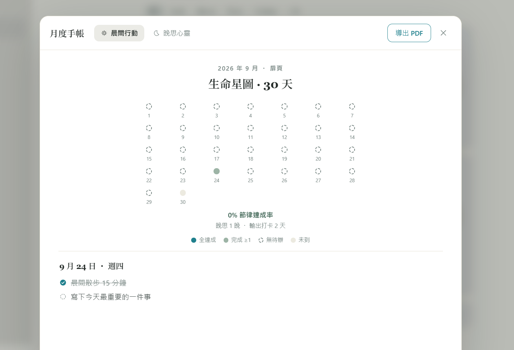
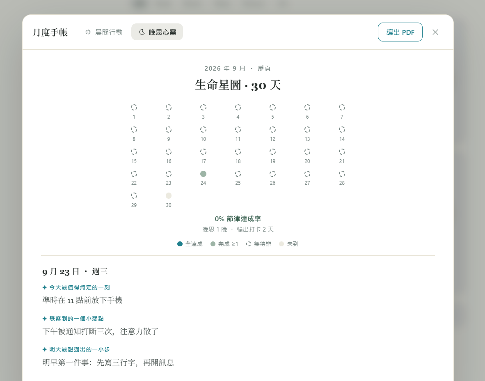

**繁體中文** | [English](README.en.md) | [简体中文](README.zh-CN.md)

# Klingon

**單檔案認知與輸出系統。** 一個 `index.html`，你的瀏覽器，你的資料——無需建置、無框架、無後端、無帳號。

## 截圖

| 晨間行動手帳 | 晚思心靈手帳 |
|:---:|:---:|
|  |  |

*月度雙手帳：30 天生命星圖、逐日手帳內頁、可列印的 A4 PDF。*

## 背景

Klingon 以**樺澤紫苑式輸出法**為骨幹：**D1** 直覺留痕（一句話捕捉靈感）→ **D3** 轉化書寫（展開成反思）→ **D7** 沉澱實踐（化為行動），構成一條溫和的 7 日記憶迴路。晨間三件聚焦開啟多巴胺，晚間三行微反思收束一天，月底所有紀錄自動沉澱成冊。

它同時也是一次「**少即是多**」的軟體實驗：全站只允許一種強調色、零彩色 emoji、不疊彈窗——只有溫潤紙白、襯線字體與輕微的聲音回饋。它被設計成「真的可以每天用」的工具，因此**永不責備你漏掉的任何一天**（記憶寬容期）。

## 功能

- **晨間待辦** — 最多 3 件聚焦事項，朝陽徽章隨完成數升起；支援拖拽排序；昨晚寫下的「明天最想邁出的一小步」會化作幽靈浮水印，按 Tab 即可採納。
- **輸出追蹤** — 雜誌式卡片搭配打孔票根（STUB 01 已顯影 → STUB 02 今日待打孔 → STUB 03 鎖定），完成階段即在票根蓋上紅色 PUNCHED 鋼印；無邊框寫作抽屜嚴格保留你的每一個換行與分段。
- **晚思覆盤** — 今日留痕輕量摺疊呈現；三行微反思即時存檔；4-7-8 呼吸節律；熄燈時響起合成頌缽。
- **月度雙手帳** — 30 天生命星圖與節律達成率；晨間行動／晚思心靈雙本切換；出版級 A4 PDF 導出（左側裝訂邊距，同日內容絕不跨頁腰斬）。
- **全域檢索** — `Ctrl / ⌘ + K` 搜尋你寫下的所有內容。
- **多視窗安全存儲** — 寫入前自動合併多視窗改動；刪除墓碑防止復活；「順序即資料」；每次儲存留存時間戳備份（最多 20 個還原點）；快照救援與歷史版本面板。
- **本地存檔** — 可選授權一個資料夾，每次儲存同步寫入明文 `klingon-data.json`；即使瀏覽器資料被清空，下次開啟自動復原。
- **導出** — 紙白／曜石雙主題分享卡（複製或下載 PNG）；整庫 JSON 備份／恢復。

## 設計原則

- 全站零彩色 emoji，所有圖標皆為 1.5px 單色幾何線條。
- 分類標籤恆為英文：**All · Book · Movie · Show · Podcast · Life**。
- 長文永遠保留換行與分段：`pre-wrap`、Georgia 襯線體、1.8 行高。
- 寫作區域物理級滅框，聚焦時僅保留底線。
- 溫潤紙白調色板：`#FBFAF4` 紙面 · `#F8F7F0` 側欄 · `#E6E2D4` 米白 · `#20808D` 綠松石強調色。

## 使用方式

1. 下載 `index.html`
2. 直接雙擊開啟（建議 Chrome 或 Edge）
3. 就這樣。

可選：點擊側欄「啟用本地存檔」，將每次儲存同步到你指定的資料夾。

## 資料與隱私

所有資料只存在你的瀏覽器 localStorage（鍵值 `klingon.v1`）與你指定的本地資料夾中，**永不上傳任何伺服器**。頁面唯一的網路請求是由 CDN 載入 html2canvas；包括圖片導出在內的所有功能皆可離線運作。

## 授權

[MIT](LICENSE) © suzie — 可自由使用、修改與衍生，歡迎保留署名。
